# Diagrama de classes do domínio

Este diagrama representa as entidades JPA que estão em `src/main/java/br/edu/uniesp/pedidocerto/internal/*/entity`.
O GitHub desenha o bloco abaixo automaticamente. A mesma modelagem em PlantUML está em
[`diagrama-classes.puml`](diagrama-classes.puml) (para exportar PNG ou PDF).

**Como ler:** `-` atributo privado, `+` método público, `~` método restrito ao pacote (só o `PedidoEntity` o chama).
Nenhuma entidade tem setters: o estado só muda pelos métodos modificadores listados em cada classe.
`*--` é composição (o filho não existe sem o pedido) e `-->` é associação navegável.

```mermaid
classDiagram
direction TB

class ClienteEntity {
  -Long id
  -String nome
  -String telefone
  -String email
  -CanalContato canalPreferencial
  -boolean ativo
  -LocalDateTime criadoEm
  +atualizarContato(telefone, email) void
  +alterarCanalPreferencial(canal) void
  +inativar() void
  +reativar() void
}

class FuncionarioEntity {
  -Long id
  -String nome
  -SetorFuncionario setor
  -boolean ativo
  +transferirParaSetor(setor) void
  +inativar() void
  +reativar() void
}

class ProdutoEntity {
  -Long id
  -String nome
  -String descricao
  -BigDecimal precoBase
  -BigDecimal horasProducaoPorUnidade
  -boolean ativo
  +reajustarPreco(novoPreco) void
  +ajustarTempoDeProducao(horasPorUnidade) void
  +alterarDescricao(novaDescricao) void
  +vincularMaterial(material) void
  +desvincularMaterial(material) void
  +inativar() void
  +reativar() void
}

class MaterialEntity {
  -Long id
  -String nome
  -String unidadeMedida
  -BigDecimal quantidadeEstoque
  -BigDecimal estoqueMinimo
  -boolean ativo
  +repor(quantidade) void
  +baixar(quantidade) void
  +ajustarEstoqueMinimo(novoMinimo) void
  +inativar() void
  +reativar() void
}

class NecessidadeMaterialEntity {
  -Long id
  -BigDecimal quantidadeNecessaria
  -BigDecimal quantidadeConsumida
  +ajustarQuantidadeNecessaria(novaQuantidade) void
  +consumir(quantidade) void
}

class CapacidadeDiaEntity {
  -Long id
  -LocalDate data
  -BigDecimal capacidadeHoras
  -BigDecimal horasComprometidas
  +reservar(horas) void
  +liberar(horas) void
  +redefinirCapacidade(novaCapacidade) void
}

class EtapaProducaoEntity {
  -Long id
  -String nome
  -int ordem
  -boolean irreversivel
  +reordenar(novaOrdem) void
  +marcarComoIrreversivel() void
  +marcarComoReversivel() void
}

class ExecucaoEtapaEntity {
  -Long id
  -StatusEtapa status
  -int percentualConcluido
  -LocalDateTime iniciadaEm
  -LocalDateTime concluidaEm
  +iniciar(responsavel, quando) void
  +atualizarProgresso(novoPercentual) void
  +concluir(quando) void
}

class PedidoEntity {
  -Long id
  -String numero
  -StatusPedido status
  -CanalContato canalOrigem
  -LocalDateTime criadoEm
  -LocalDateTime aprovadoEm
  -LocalDateTime dataEntregaPrevista
  -BigDecimal valorTotal
  -int versao
  -String motivoCancelamento
  +adicionarItem(produto, quantidade, personalizacao) ItemPedidoEntity
  +removerItem(item) void
  +alterarQuantidadeDoItem(item, novaQuantidade) void
  +alterarPersonalizacaoDoItem(item, novaPersonalizacao) void
  +reagendarEntrega(novaData, agora) void
  +aprovar(agora) void
  +registrarPagamento(tipo, forma, valor, pagoEm, registradoPor) PagamentoEntity
  +planejarEtapa(etapa) ExecucaoEtapaEntity
  +definirNecessidadeDeMaterial(material, quantidade) NecessidadeMaterialEntity
  +iniciarProducao() void
  +marcarComoPronto() void
  +confirmarEntrega(responsavel, quando) void
  +cancelar(motivo) void
  +solicitarAlteracao(descricao, solicitadaPor, agora) AlteracaoPedidoEntity
  +aprovarAlteracao(alteracao, quando) void
  +confirmarLeituraDaAlteracao(alteracao, funcionario, quando) void
  +valorPago() BigDecimal
  +saldoPendente() BigDecimal
}

class ItemPedidoEntity {
  -Long id
  -int quantidade
  -BigDecimal precoUnitario
  -String personalizacao
  ~alterarQuantidade(novaQuantidade) void
  ~alterarPersonalizacao(novaPersonalizacao) void
  +subtotal() BigDecimal
}

class AlteracaoPedidoEntity {
  -Long id
  -String descricao
  -LocalDateTime solicitadaEm
  -ZonaAlteracao zona
  -StatusAlteracao status
  -BigDecimal custoAdicional
  -int diasAdicionais
  -LocalDateTime aprovadaEm
  -LocalDateTime confirmadaEm
  -String motivoRecusa
  +proporCusto(custoAdicional, diasAdicionais) void
  +recusar(motivo) void
  ~aprovarPeloCliente(quando) void
  ~confirmarLeituraDaProducao(funcionario, quando) void
}

class EntregaEntity {
  -Long id
  -ModalidadeEntrega modalidade
  -String enderecoEntrega
  -boolean saldoConferido
  -LocalDateTime entregueEm
  +definirModalidade(modalidade, endereco) void
  ~registrar(responsavel, saldoPendente, quando) void
}

class PoliticaAlteracaoEntity {
  -Long id
  -String nome
  -int horasSemCusto
  -int percentualLimiteComCusto
  -int horasFechamentoAntesDaEntrega
  -boolean ativa
  +ajustarJanelas(horasSemCusto, percentualLimite, horasFechamento) void
  +ativar() void
  +desativar() void
  +classificar(agora, aprovadoEm, entregaPrevista, percentualProduzido, etapaIrreversivelConcluida) ZonaAlteracao
}

class PagamentoEntity {
  -Long id
  -TipoPagamento tipo
  -FormaPagamento forma
  -BigDecimal valor
  -LocalDateTime pagoEm
  -boolean conferido
  -LocalDateTime conferidoEm
  +conferir(responsavel, quando) void
}

class ContatoEntity {
  -Long id
  -CanalContato canal
  -String mensagem
  -LocalDateTime recebidoEm
  -boolean foraDoHorario
  -LocalDateTime tratadoEm
  +vincularAoPedido(pedido) void
  +marcarComoTratado(funcionario, quando) void
}

class CanalContato {
  <<enumeration>>
  WHATSAPP
  INSTAGRAM
  PRESENCIAL
}
class SetorFuncionario {
  <<enumeration>>
  ATENDIMENTO
  PRODUCAO
  ADMINISTRACAO
  ENTREGAS
}
class StatusPedido {
  <<enumeration>>
  ORCAMENTO
  APROVADO
  EM_PRODUCAO
  PRONTO
  ENTREGUE
  CANCELADO
}
class ZonaAlteracao {
  <<enumeration>>
  VERDE
  AMARELA
  VERMELHA
}
class StatusAlteracao {
  <<enumeration>>
  SOLICITADA
  AGUARDANDO_CLIENTE
  APROVADA_PELO_CLIENTE
  CONFIRMADA_PELA_PRODUCAO
  RECUSADA
}
class ModalidadeEntrega {
  <<enumeration>>
  RETIRADA
  DOMICILIO
}
class TipoPagamento {
  <<enumeration>>
  SINAL
  PARCIAL
  SALDO
}
class FormaPagamento {
  <<enumeration>>
  PIX
  DINHEIRO
  CARTAO
  TRANSFERENCIA
}
class StatusEtapa {
  <<enumeration>>
  PENDENTE
  EM_ANDAMENTO
  CONCLUIDA
}

%% Agregado Pedido (composição)
PedidoEntity "1" *-- "0..*" ItemPedidoEntity : itens
PedidoEntity "1" *-- "0..*" PagamentoEntity : pagamentos
PedidoEntity "1" *-- "0..*" AlteracaoPedidoEntity : alteracoes
PedidoEntity "1" *-- "0..*" ExecucaoEtapaEntity : execucoesEtapa
PedidoEntity "1" *-- "0..*" NecessidadeMaterialEntity : necessidadesMaterial
PedidoEntity "1" *-- "0..1" EntregaEntity : entrega

%% Associações do pedido
PedidoEntity "0..*" --> "1" ClienteEntity : cliente
PedidoEntity "0..*" --> "1" FuncionarioEntity : atendente
PedidoEntity "0..*" --> "1" PoliticaAlteracaoEntity : politicaAlteracao

%% Catálogo e produção
ItemPedidoEntity "0..*" --> "1" ProdutoEntity : produto
ProdutoEntity "0..*" -- "0..*" MaterialEntity : materiaisPadrao
NecessidadeMaterialEntity "0..*" --> "1" MaterialEntity : material
ExecucaoEtapaEntity "0..*" --> "1" EtapaProducaoEntity : etapa
ExecucaoEtapaEntity "0..*" --> "0..1" FuncionarioEntity : responsavel

%% Responsáveis
PagamentoEntity "0..*" --> "1" FuncionarioEntity : registradoPor
PagamentoEntity "0..*" --> "0..1" FuncionarioEntity : conferidoPor
AlteracaoPedidoEntity "0..*" --> "1" FuncionarioEntity : solicitadaPor
AlteracaoPedidoEntity "0..*" --> "0..1" FuncionarioEntity : confirmadaPor
EntregaEntity "0..*" --> "0..1" FuncionarioEntity : responsavel

%% Atendimento
ContatoEntity "0..*" --> "1" ClienteEntity : cliente
ContatoEntity "0..*" --> "0..1" PedidoEntity : pedido
ContatoEntity "0..*" --> "0..1" FuncionarioEntity : tratadoPor

%% Uso das enumerações
ClienteEntity ..> CanalContato
PedidoEntity ..> CanalContato
PedidoEntity ..> StatusPedido
ContatoEntity ..> CanalContato
FuncionarioEntity ..> SetorFuncionario
AlteracaoPedidoEntity ..> ZonaAlteracao
AlteracaoPedidoEntity ..> StatusAlteracao
EntregaEntity ..> ModalidadeEntrega
PagamentoEntity ..> TipoPagamento
PagamentoEntity ..> FormaPagamento
ExecucaoEtapaEntity ..> StatusEtapa
```

## Relacionamentos JPA usados

| Anotação | Onde |
|---|---|
| `@OneToOne` | `PedidoEntity` ↔ `EntregaEntity` (dono da chave: `EntregaEntity.pedido`) |
| `@OneToMany` / `@ManyToOne` | `Pedido` → itens, pagamentos, alterações, execuções de etapa e necessidades de material; `Pedido` → `Cliente`, `Funcionario`, `PoliticaAlteracao`; `Item` → `Produto`; `Execucao` → `Etapa`; `Contato` → `Cliente`/`Pedido` |
| `@ManyToMany` | `ProdutoEntity` ↔ `MaterialEntity` (tabela `produto_material`, materiais padrão do produto) |
| Entidade associativa | `NecessidadeMaterialEntity` liga `Pedido` e `Material` guardando quantidades (relação muitos-para-muitos com atributos) |
